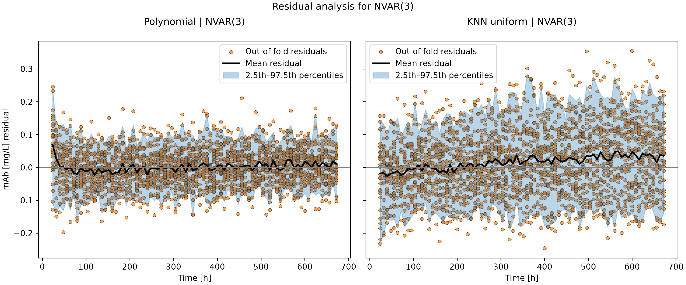
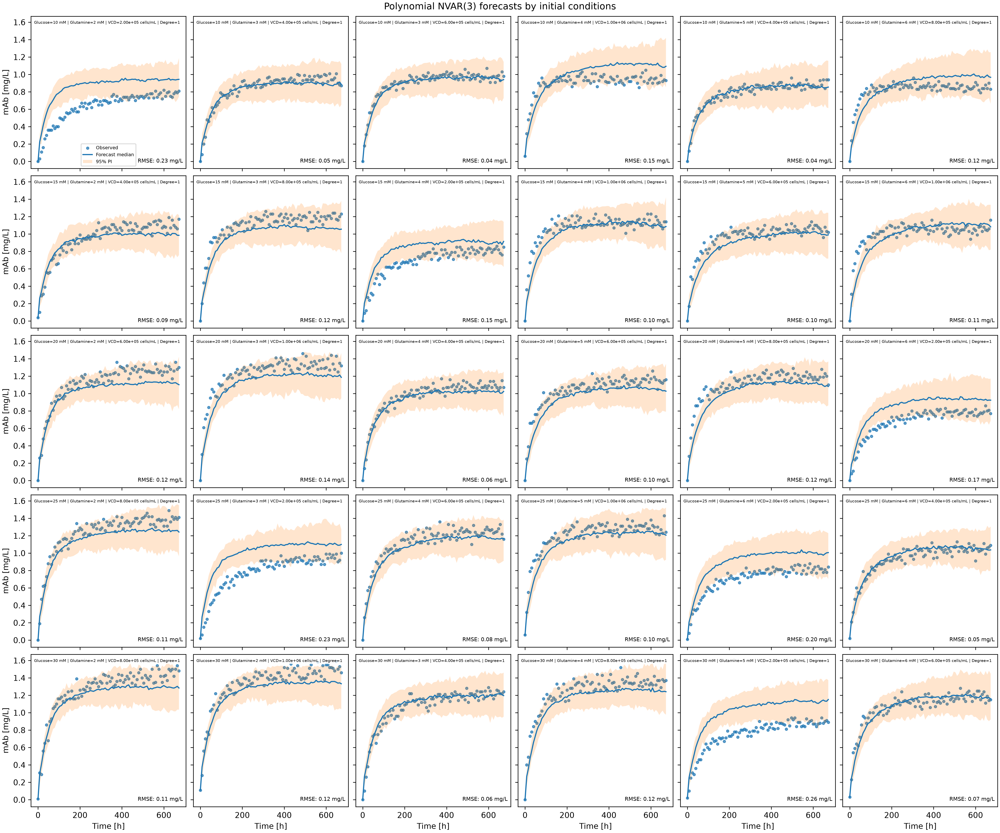
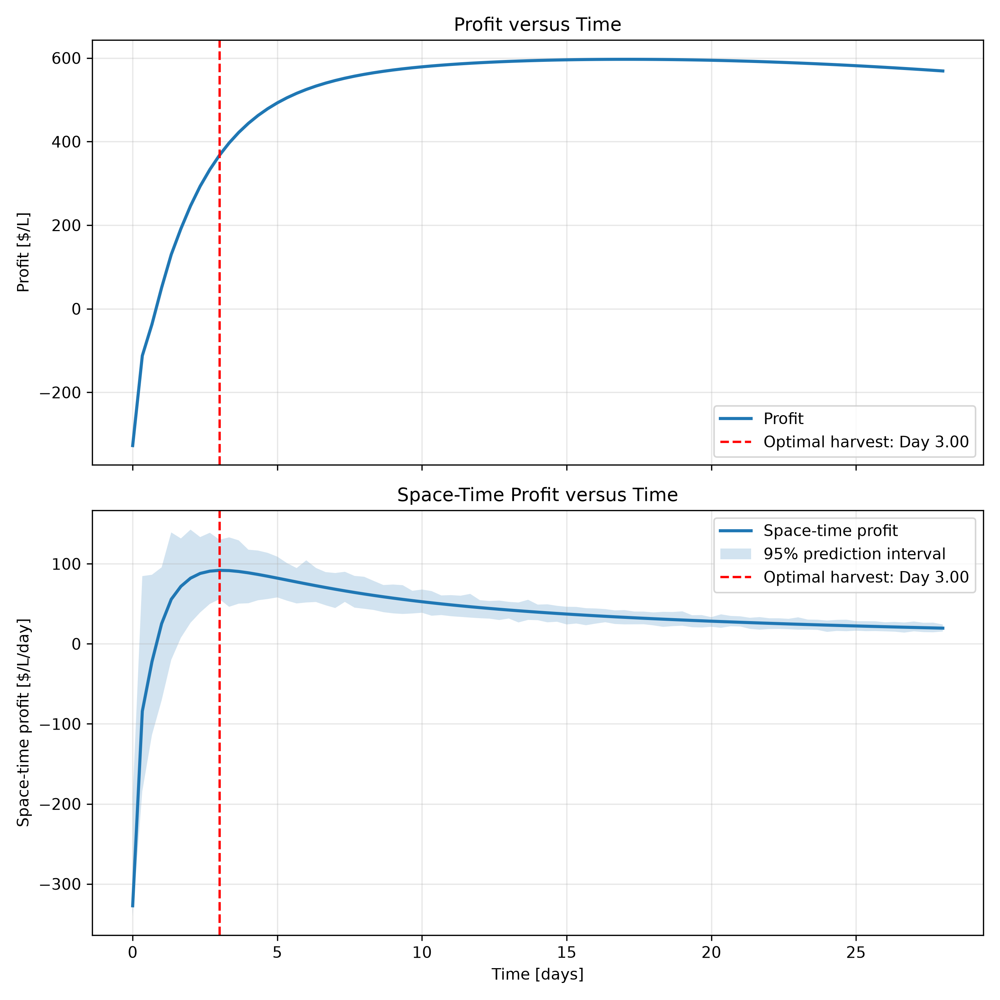
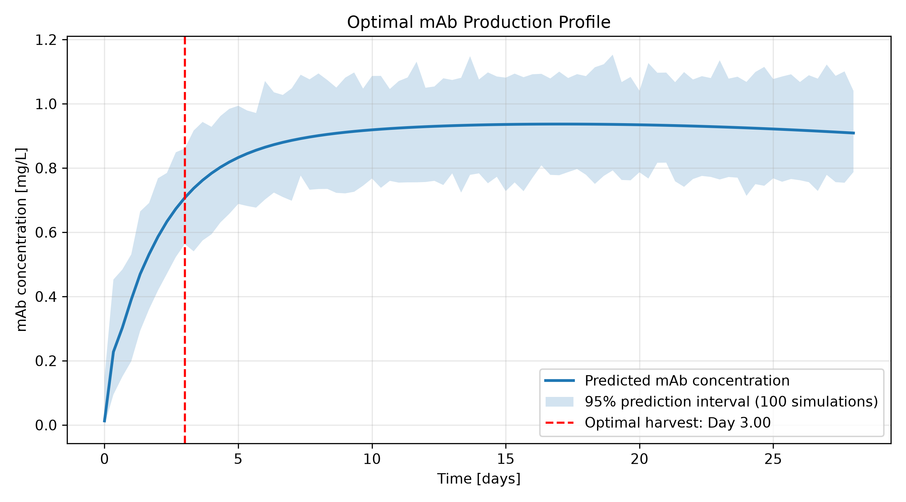

# Optimization of mAbs Initial Conditions to Maximize Profits
In this project, we attempt to do a case study where a pharmaceutical company is producing antibodies to help treat cancer. This code is uses a Non-linear Vector Autoregression Model (NVAR) to determine the best models to predict the effects of glucose (mM), glutamine (mM), and viable cell density or VCD (cells/mL) on monoclonal antibodies (mAbs) production. Using this model we attempt find the optimal starting conditions for the maximum space-time profit for this company.

## Highlights
* Analyzed 30 fermentation batches to identify key factors influencing mAb production.
* Built and validated machine learning models to predict mAb production from historical process data.
* Applied time-series modeling to capture how changing culture conditions affect fermentation performance.
* Developed an economic optimization tool to identify the most profitable fermentation conditions.
* Identified the optimal harvest day by tracking predicted profit over time and determining when profitability peaked

## Environment
The following coding language, tools and libraries used for this project are:
* Python (ver 3.13.5) 
* Matplotlib (ver 3.11.0)
* NumPy (ver 2.5.2)  
* pandas (ver 3.0.6) 
* scikit-learn (ver 1.9.0)

## Code Design

### main.py

The `main.py` file controls the execution of the project. It imports the experimental data, defines the model settings, and runs the model and economic analyses. NumPy (`numpy`) is used for numerical operations and arrays, while Pandas (`pandas`) is used to import, organize, and manipulate the experimental datasets. The `os` library manages file paths and creates the output folders.

The program begins by defining the selected Batch IDs and the seven process variables used in the multivariable model: glucose, glutamine, lactate, ammonia, viable cell density (VCD), total cell density (TCD), and monoclonal antibody concentration (mAb). It also defines the maximum lag order, polynomial degree, number of KNN neighbours, cross-validation splits, and number of forecast simulations.

Pandas `read_csv()` imports the initial conditions from `initial_conditions.csv` and the time-series data from the individual batch CSV files. Each batch file is identified using its Batch ID and follows the naming format `batch_XXXX.csv`. The Batch ID is added as a column to each imported dataset. The individual datasets are then combined using `pd.concat()` to create one DataFrame containing all selected batches.

The program checks that all requested batch files exist and that the required process variables and time columns are present. It also checks that every selected batch has matching initial conditions and that no duplicate Batch IDs exist. Once the data has passed these checks, the combined DataFrame and initial conditions are passed to the `ModelAnalysis` class.

The `fit_nvar_models()` function is called to train and evaluate the NVAR models using Leave-One-Batch-Out Cross-Validation (LOBOCV). After model evaluation, `white_noise_analysis()` examines the model residuals. Finally, `EconomicAnalysis` is initialized and `run_dashboard()` allows the user to select the model, lag order, and initial-condition ranges for the economic optimization.

### functions.py

The `functions.py` file contains supporting functions used to prepare the time-series data and retrieve initial conditions. NumPy is used to create and combine the numerical arrays required by the models, while Pandas is used to select observations from the DataFrame. These functions are called by the classes in `classes.py` whenever training data, forecasts, or initial conditions are required.

The `generate_x_lag_cur_var()` function prepares the input and output arrays for the multivariable NVAR model. It processes each batch independently and separates the process variables into lagged inputs, `x_lag`, and current observations, `x_cur`. The lag order, represented by `p`, determines how many previous time points are used to predict the current state. For example, an NVAR(3) model uses the process variables at times \(t-1\), \(t-2\), and \(t-3\) to predict all process variables at time \(t\).

Each lag contains the complete process state, rather than just one variable. The lagged states are combined into a single input vector, while the current observations form the prediction targets. The function also returns the corresponding time values and Batch IDs. Importantly, lagged arrays are generated separately for each batch before being combined. This prevents observations from the end of one batch from being used as lagged inputs for another batch.

The `generate_x_lag_cur_ar()` function follows the same approach but prepares data for a single-variable autoregressive model instead of a multivariable model. The `load_initial_conditions()` function loads the initial-condition dataset when one has not already been provided. The `fetch_initial_condition()` function retrieves the initial conditions belonging to a specific Batch ID. These values are used when initializing forecasts. Finally, `progress_bar()` displays the progress of lengthy model-fitting and analysis calculations.

### classes.py

The `classes.py` file contains the main modelling and economic analysis components. It uses NumPy and Pandas for numerical calculations and data handling, Matplotlib (`matplotlib.pyplot`) to generate figures, and `itertools` to generate combinations of initial operating conditions. Scikit-learn (`sklearn`) provides the preprocessing, regression models, parameter selection, cross-validation, and error calculations.

### StandardScalerVAR

The `StandardScalerVAR` class standardizes the lagged input data before it is used for model fitting. Since the process variables have different units and numerical ranges, scaling prevents variables with larger numerical values from dominating the model input. The `fit()` function calculates the mean and standard deviation of each process variable across all lag positions. The same scaling values are applied to that variable at every lag. The `transform()` function standardizes the data, while `inverse_transform()` converts values back to their original scale. This class is used within the model pipelines created by `ModelAnalysis`.

### ModelAnalysis

The `ModelAnalysis` class performs NVAR model fitting, parameter selection, forecasting, and validation. Nonlinear Vector Autoregression (NVAR) is a nonlinear time-series model that predicts multiple process variables simultaneously using their previous observations. Unlike a standard Vector Autoregression (VAR), which uses linear relationships, NVAR allows nonlinear relationships between the lagged inputs and current outputs. This is useful for describing nonlinear bioprocess behaviour, such as the sigmoid-shaped growth profile of a cell culture.

The model structure is represented by:

$x_t = f(x_{t-1},x_{t-2},\ldots,x_{t-p})+\epsilon_t$

Here, \(p\) is the lag order, \(f\) is the function used to predict the current process state, and \(\epsilon_t\) represents the prediction error. The model uses the same input and output structure as VAR, but the function \(f\) can describe nonlinear relationships.

The `_make_model()` function creates the two NVAR approaches evaluated in this project. The Polynomial model uses Scikit-learn's `PolynomialFeatures` to generate nonlinear combinations of the lagged variables, followed by `LinearRegression` to predict the current process state. The KNN uniform model uses `KNeighborsRegressor` to identify nearby observations in the training data. Each of the selected neighbours contributes equally to the prediction. These approaches allow the project to compare polynomial regression with a non-parametric K-nearest neighbours model.

The `_fit_best_model()` function prepares the lagged arrays using `generate_x_lag_cur_var()` and applies `GridSearchCV` to select the model parameters. For the Polynomial model, the polynomial degree is tested from 1 to 4. For KNN, the number of neighbours is tested from 2 to 16. The parameter combination with the lowest cross-validation RMSE is selected.

The cross-validation method used within `GridSearchCV` is `GroupKFold`. It uses the Batch IDs as groups to ensure that observations from the same batch are not divided between training and validation folds. This is important for time-series data because observations within a batch are related and should remain together during validation.

The `fit_nvar_models()` function performs the overall LOBOCV evaluation. In each iteration, one complete batch is excluded from training and used to test the model. The model is fitted using the remaining batches, and its predictions are compared with the observations from the excluded batch. This process is repeated until every selected batch has been used as the test batch. LOBOCV therefore evaluates how well the model predicts an unseen experimental batch rather than simply predicting additional observations from batches it has already encountered.

For each model type and lag order, the function records the mAb Root Mean Squared Error (RMSE) for every excluded batch. The mean and standard deviation of these errors are calculated to evaluate model performance. The results are saved as CSV files, while Matplotlib generates plots comparing observed and predicted mAb concentrations.

The `_forecast()` function generates recursive forecasts using the fitted model. It begins with the initial process state and predicts the next time point using the previous lagged states. Each new prediction is then used to predict the following time point. Residuals from the training data are randomly added to the predictions across multiple simulations to represent prediction uncertainty. The median forecast and lower and upper prediction intervals are calculated from these simulations.

The `white_noise_analysis()` function evaluates the residuals produced by the fitted models. It examines their mean, standard deviation, and lag-one correlation, and generates residual plots. Residuals that more closely resemble white noise indicate that fewer systematic patterns remain unexplained by the model.

### EconomicAnalysis

The `EconomicAnalysis` class uses the selected NVAR model to predict production profiles and determine the initial operating conditions and harvest time that maximize economic performance.

The `run_dashboard()` function collects the selected model type, lag order, and ranges for initial glucose, glutamine, and VCD. The `_read_integer()` and `_read_range()` functions validate these inputs to ensure they are within the allowed limits. The ranges are based on the experimental initial conditions, helping define the model's valid operating region.

The `_fit_model()` function trains the selected NVAR model using all available batches. It again uses `GridSearchCV` and `GroupKFold` to select the best model parameters while keeping batches separated during cross-validation. The `_calculate_accuracy()` function then uses the previous LOBOCV results to determine the mean and standard deviation of the mAb RMSE for validation batches that fall within the selected initial-condition ranges.

The `_set_time_grid()` function establishes the prediction time points using the median time interval between experimental observations. The `_initial_state()` function creates the starting process state using the average initial values across the experimental batches, then replaces glucose, glutamine, and VCD with the values being evaluated. The `_predict_profile()` function uses this initial state to generate a complete production profile through recursive NVAR predictions. Predictions are clipped to prevent negative concentrations and excessively large values.

The `_calculate_economics()` and `_evaluate_condition()` functions calculate the economic performance of each predicted production profile. The calculations include cell culture cost, cell culture value, total profit, space-time profit (STP), and space-time yield (STY). The equations used are:

$Cost = 10(Glucose)+20(Glutamine)+0.0005(VCD)$

$Value = 1000(mAb)$

$Profit = Value-Cost$

$STP = \frac{Profit}{Time+1}$

$STY = \frac{mAb}{Time+1}$

The `analyze_conditions()` function performs the economic grid search. It generates glucose values in increments of 5 mM, glutamine values in increments of 1 mM, and initial VCD values in increments of 200,000 cells/mL. The `itertools.product()` function generates every possible combination of these conditions. For each combination, the NVAR model predicts the production profile and calculates the maximum profit and maximum STP across the available harvest times.

The maximum values are identified using `np.argmax()` within each predicted profile. After every combination has been evaluated, the results are sorted separately by maximum total profit and maximum STP. The highest-ranked combination in each ranking represents the operating conditions that maximize that objective. These are evaluated separately because the harvest time that produces the highest total profit may differ from the harvest time that produces the highest profit per unit of time.

Finally, `_simulate_economic_uncertainty()` uses the mean validation RMSE to simulate variation in predicted mAb concentration and calculate 95% prediction intervals for the economic results. `_generate_figures()` creates plots of the predicted production profile, profit, STP, and STY. The `_save_results()` function exports the recommended conditions, model accuracy, validation batches, and predicted production profile to CSV files. The final results provide the recommended initial conditions and harvest time for both maximum total profit and maximum space-time profit.
## Analysis
### Selection of Data Range for Model
In this project, our hypothetical pharmaceutic company has only the resources to conduct 30 seperate batch process experiments for data collection for this model. This limits the amount of data we can gather to make an accurate model, and hence using the maximum range of data (Glucose: 5-35 mM, Glutamine:1-7 mM VCD:2.00x10^5-1.40x10^6 cells/mL) would severally limit the number of combinations we can do for each parameter and the possibility of create less accurate predictions when use this model. Therefore, we decide to reduce the range slightly for this model, in hopes it would more accurate on the data so we chose to redoce the range to fives for each model. 

In terms of the range we chose we shortened the range to have at least five points with glucose ranging from 10-30 mM, glutamine ranging from 2-6 mM and finally VCD ranging 2.00x10^5-1.00x10^6 cells/mL. We chose these ranges based off two things:
1) Starting costs
2) Optimal conditions for growth

As shown in Table 1, increasing glucose, glutamine, and VCD also increases the initial cost of the batch process. This is particularly evident with VCD. This would hopefully account for the largest proportion of initial costs. Consequently, we anticipate that lower viable cell densities may offer greater cost efficiency. However, we maintained a middle range for glucose and glutamine because of their importance in supporting cell growth and mAb production. Glucose serves as a primary energy source for mammalian cells, supporting cellular energy production and biomass synthesis [1]. Hence, having a larger glucose concentration may increase mAb via increasing VCD count compensating for the higher initial costs. Similarly, glutamine supports cellular energy metabolism and provides nitrogen for the synthesis of cellular components required for cell growth and protein production, which is important for antibody production [2]. However, excessive glucose availability and/or glutamine metabolism can lead to lactate and ammonia accumulation respectfully, which may inhibit cell growth and negatively affect mAb productivity. Therefore, maintaining moderate glucose and glutamine concentrations allows us to investigate their influence on cell growth and mAb production while reducing the potential for inhibitory by-product accumulation and balancing nutrient requirements against initial material costs.

***Table 1: Cost Analysis on initial conditions***

| Initial condition | Minimum initial condition | Cost ($/L) | Cost contribution (%) | Maximum initial condition | Cost ($/L) | Cost contribution (%) |
|-------------------|---------------------------|------------|-----------------------|---------------------------|------------|-----------------------|
| Initial Glucose (mM) | 5  | 50 | 29.4 | 35  | 350 | 27.3 |
| Initial Glutamine (mM) | 1  | 20 | 11.8 | 7  | 140 | 9.1 |
| Initial VCD (cells/mL) | 200,000  | 100 | 58.8 | 1,400,000  | 700 | 63.6 |

After selecting the range, we selected batches that would distribute all three parameters evenly across our model, meaning that each level of glucose, glutamine, and initial VCD was paired with every level of the other two parameters at least once across the selected batches as can be seen in Table 2. No replicates were performed to maximize the diversity of the dataset and include a broader range of initial operating conditions. By testing different combinations of glucose, glutamine, and initial viable cell density, we aimed to capture a wider range of process behaviours and relationships between the input variables and mAb production. This broader coverage was expected to provide the model with more varied training data, allowing it to better identify patterns across different conditions and potentially improve its predictive accuracy and generalizability.

***Table 2: Selected Batches for Model and Their Initial Parameters***

|Batch ID|Glucose (mM)|Glutamine (mM)|VCD (cells/mL)|
|--------|------------|--------------|--------------|
|169     |10          |2             |200,000       |
|193     |10          |3             |400,000       |
|196     |10          |3             |600,000       |
|223     |10          |4             |1,000,000     |
|235     |10          |5             |400,000       |
|262     |10          |6             |800,000       |
|319     |15          |2             |400,000       |
|346     |15          |3             |800,000       |
|358     |15          |4             |200,000       |
|370     |15          |4             |1,000,000     |
|385     |15          |5             |600,000       |
|412     |15          |6             |1,000,000     |
|469     |20          |2             |600,000       |
|496     |20          |3             |1,000,000     |
|508     |20          |4             |400,000       |
|532     |20          |5             |600,000       |
|535     |20          |5             |800,000       |
|547     |20          |6             |200,000       |
|619     |25          |2             |800,000       |
|631     |25          |3             |200,000       |
|658     |25          |4             |600,000       |
|685     |25          |5             |1,000,000     |
|694     |25          |6             |200,000       |
|697     |25          |6             |400,000       |
|766     |30          |2             |800,000       |
|769     |30          |2             |1,000,000     |
|781     |30          |3             |400,000       |
|808     |30          |4             |800,000       |
|820     |30          |5             |200,000       |
|847     |30          |6             |600,000       |

### Selection and Comparison of Model

After batch selection we ran our NVAR simulator to compare selected using Polynomial vs k-nearest neighbors uniform modeling. We chose NVAR over vector autoregression (VAR) due to fact that we have multiple variables that interact with each other in complex ways, that can effect mAb production, and more dynamic behaviour than a linear relation could model accurately. In terms of why we compared Polynomial Regression and KNN, both provide reasonable approaches for modelling the nonlinear relationships between process conditions and mAb production. Polynomial Regression can capture continuous nonlinear effects of glucose, glutamine, lactate, ammonia, and VCD on cell growth and antibody production, while KNN uses similarities between historical culture conditions to identify patterns in how these variables influence process behaviour. Comparing both approaches allows us to evaluate which model better captures the effects of nutrient availability, metabolite accumulation, and cell density on culture performance and mAb production over time. For KNN we chose uniform due needing less computational power.

Looking the results in Table 3, we can see that Polynomial regression preformed better than KNN regression, producing a lower LOBOCV mAb RMSE value across all five lag orders, with lag order of p=3, being the lowest. This suggests that relation between mAb production and the measured variables follow a continuous trend due to difference of initial conditions directly impacting cell growth and antibody production.

***Table 3: RMSE Scores of NVAR(p) Models for Polynomial and KNN Uniform***

|Model      |p  |Mean LOBOCV mAb RMSE [mg/L]|SD LOBOCV mAb RMSE [mg/L]|
|-----------|---|---------------------------|-------------------------|
|Polynomial |1  |          0.15017          |        0.07032          |
|Polynomial |2  |          0.12651          |        0.06030          |
|Polynomial |3  |          0.11826          |        0.05475          |
|Polynomial |4  |          0.12221          |        0.04879          |
|Polynomial |5  |          0.13008          |        0.04269          |
|KNN uniform|1  |          0.19968          |        0.09381          |
|KNN uniform|2  |          0.19891          |        0.09581          |
|KNN uniform|3  |          0.20480          |        0.09549          |
|KNN uniform|4  |          0.21613          |        0.10521          |
|KNN uniform|5  |          0.22225          |        0.10581          |

Further evidence supporting the selection of Polynomial NVAR(3) over KNN NVAR(3) can be seen in Figure 1, which presents the residual white noise analysis for both models. Ideally, residuals should fluctuate randomly around zero without showing noticeable trends or patterns, indicating that the model has captured the underlying relationships in the data. Both models generally produce residuals close to zero but, KNN exhibits a slight upward trend over time, suggesting that it may not fully capture the changing behaviour of the culture throughout the batch. In comparison, Polynomial NVAR(3) initially exhibits larger positive residuals, indicating lower prediction accuracy during the early stages of the batch. However, these residuals decrease over time and eventually fluctuate around zero with relatively little noticeable pattern. This implies that the Polynomial model becomes better at capturing the process behaviour as the batch progresses. Although it has some limitations in predicting early culture dynamics, the overall residual pattern provides further support for selecting Polynomial NVAR(3), as it demonstrates less evidence of systematic error over the course of the batch.

***Figure 1: White Noise Analysis of mAbs Residuals for NVAR(3) Polynomial and KNN Models***

### Advantages and Limitations of Model

Figure 2, shows the results of our LOBOCV Polynomial NVAR(3) model when compare model fitted to the training data can predict our validation data. As seen here many of our models show great accuracy when it comes to predicting mAb production under certain initial condition but not so with others. In particular, for upper and lower of initial VCD, we can see it either over shoots its prediction, not accurately predict mAb concentration as seen fpr 2.00x10^5 or unable to model the flatness of the lag phase for initial of 1.00x10^6 cells/mL. Further more RMSE increase slightly (though al be it not as large) for the upper end of glucose and glutamine concentrations, though most data points seem to stay in the 95% predictive interval (PI). Do this, to make sure our model remains accurate, we further reduced the range of our model to maintain the accuracy of our predictions during the economic analysis with glucose range being 10-25 mM, glutamine range being 2-5 mM, and VCD being reduced to 4.00x10^5-8.00x10^5 cells/mL. This increase our accuracy of model to an RMSE of 0.087 and a standard devation of 0.030. This significant improvement in our models accuracy, though at the expense of being able to investigate a wider range of parameters.

***Figure 2: Forecasting Initial Conditions for NVAR(3) Polynomial Model***

Another limitation of the model can be observed in Figure 2, where it does not always accurately capture the exponential growth phase or the subsequent lag phase of the culture. These discrepancies indicate that the model has difficulty representing certain changes in cell growth throughout the batch, which can affect the accuracy of its predictions. This is also reflected in Figure 1, where the initial positive residuals suggest that the model has greater difficulty predicting process behaviour during the earlier stages of the batch. Although the residuals eventually stabilize around zero, the initial prediction errors highlight a limitation in capturing the transition between different growth phases. Consequently, inaccuracies during these stages may influence the predicted cell density and subsequent mAb production profiles.

Despite these limitations, Polynomial NVAR(3) demonstrates several advantages. The model provides reasonably accurate predictions, with most observed values falling within the 95% prediction intervals across the tested initial-condition ranges. Its ability to capture nonlinear relationships between nutrient availability, metabolite accumulation, and cell density allows it to represent the interconnected effects of glucose, glutamine, lactate, ammonia, and VCD on mAb production. Additionally, by incorporating three previous time points, the model accounts for the recent history of the culture when predicting future process conditions. Its ability to predict multiple process variables also allows the overall behaviour of the culture to be evaluated, rather than focusing solely on mAb concentration.s

### Effects of Initial Conditions on Antibody Production

As shown in Table 4, the initial conditions of the cell culture influence both space-time profit (STP) and space-time yield (STY). Increasing glucose concentration generally improves STY by providing more substrate for cell growth and mAb production. For example, at 2 mM glutamine and an initial VCD of 4.00x10^5 cells/mL, increasing glucose from 10 to 25 mM increases STY from 0.1768 to 0.2046 mg/L/day. However, STP remains relatively constant, decreasing slightly from 91.84/L/day to $91.55/L/day, as the additional mAb value is offset by higher glucose costs. Excess glucose consumption can also promote lactate accumulation, which may inhibit cell growth [3, 4]. Similarly, increasing glutamine from 2 to 4 mM generally reduces both STP and STY. Although glutamine supports cell growth and protein synthesis, its metabolism produces ammonia, which can inhibit cell growth and reduce antibody production when it accumulates [5, 6]. Therefore, higher nutrient concentrations may increase production costs and contribute to unfavourable culture conditions without providing a proportional increase in mAb production.

***Table 4: Ranking of Best 24 Space-Time Profit (STP) Initial Conditions Economic Polynomial NVAR(3) Analysis***

|STP Rank|Glucose [mM]|Glutamine [mM]|Initial VCD [cells/mL]|Harvest time for maximum STP [d]|Maximum space-time profit [$/L/day]|Space-time yield [mg/L/day]|Cell culture cost [$/L]|Cell culture value at maximum STP [$/L]|
|--------|------------|--------------|----------------------|--------------------------------|-----------------------------------|---------------------------|-----------------------|---------------------------------------|
|1       |10          |2             |400000                |3                               |91.84                              |0.1768                     |340                    |707.35                                 |
|2       |15          |2             |400000                |3.33                     |91.56                              |0.1815                     |390                    |786.77                                 |
|3       |20          |2             |400000                |3.33                   |91.55                              |0.193                      |440                    |836.75                                 |
|4       |25          |2             |400000                |3.33                   |91.55                              |0.2046                     |490                    |886.73                                 |
|5       |25          |3             |400000                |3.66                  |79.82                              |0.1891                     |510                    |882.5                                  |
|6       |20          |3             |400000                |3.66                    |79.45                              |0.178                      |460                    |830.8                                  |
|7       |10          |3             |400000                |3.33                    |79.1                               |0.1621                     |360                    |702.76                                 |
|8       |15          |3             |400000                |3.33                   |79.09                              |0.1737                     |410                    |752.74                                 |
|9       |25          |2             |600000                |4                               |75.79                              |0.1937                     |590                    |968.97                                 |
|10      |20          |2             |600000                |4                               |75.15                              |0.1831                     |540                    |915.78                                 |
|11      |15          |2             |600000                |3.66                    |74.55                              |0.1795                     |490                    |837.91                                 |
|12      |10          |2             |600000                |3.66                    |74.18                              |0.1684                     |440                    |786.2                                  |
|13      |25          |4             |400000                |4                               |68.67                              |0.1746                     |530                    |873.35                                 |
|14      |20          |4             |400000                |4                               |68.03                              |0.164                      |480                    |820.17                                 |
|15      |15          |4             |400000                |4                               |67.4                               |0.153                      |430                    |766.99                                 |
|16      |10          |4             |400000                |3.66                    |67.02                              |0.1484                     |380                    |692.79                                 |
|17      |25          |3             |600000                |4.33                    |65.21                              |0.1795                     |610                    |957.79                                 |
|18      |20          |3             |600000                |4.33                   |64.37                              |0.1693                     |560                    |903.33                                 |
|19      |15          |3             |600000                |4.33                    |63.53                              |0.1591                     |510                    |848.86                                 |
|20      |10          |3             |600000                |4                               |62.89                              |0.1548                     |460                    |774.45                                 |
|21      |25          |2             |800000                |4.66                   |62.16                              |0.1839                     |690                    |1042.25                                |
|22      |20          |2             |800000                |4.66                    |61.18                              |0.1741                     |640                    |986.68                                 |
|23      |15          |2             |800000                |4.33                     |60.21                              |0.1708                     |590                    |911.11                                 |
|24      |10          |2             |800000                |4.33                    |59.37                              |0.1606                     |540                    |856.65                                 |

Initial VCD also has a substantial effect on economic performance. Increasing VCD from 4.00x10^5 to 6.00x10^5 and 8.00x10^5 cells/mL generally decreases STP. For example, at 25 mM glucose and 2 mM glutamine, STP decreases from 91.55 to 75.79 dollars and $62.16/L/day, respectively. Although a higher initial cell density may support greater early production, it also increases culture costs and nutrient demand. Greater nutrient consumption can contribute to lactate and ammonia accumulation, potentially affecting cell growth and viability [4]. This could help explain why higher initial VCD conditions generally require longer harvest times to reach their maximum STP.

The relationship between harvest time, STY, and STP is important when selecting the optimal initial conditions. Extending the culture period may increase the final mAb concentration, but the additional production must be considered relative to the extra time required. STP also accounts for the economic value of the mAb produced after subtracting cell culture costs. Consequently, a condition with higher STY does not necessarily produce the highest STP. For example, the highest STY of 0.2046 mg/L/day was achieved using 25 mM glucose, 2 mM glutamine, and an initial VCD of 4.00x10^5 cells/mL. However, the highest STP of $91.84/L/day was obtained using 10 mM glucose under the same glutamine and VCD conditions. The additional mAb production at the higher glucose concentration was insufficient to offset its increased cost. Overall, these results highlight the importance of balancing nutrient availability, initial cell density, and harvest time to maximize the economic performance of mAb production.

### Optimal Conditions for Maximized Time-Space Profit

The optimal harvest time was determined by evaluating the predicted STP throughout the batch, as shown in Figure 3. STP initially increases as mAb concentration rises during cell culture, reaching a maximum of \$91.84/(L·day) on Day 3. After this point, STP gradually decreases because the additional mAb produced does not compensate for the increased batch duration. Therefore, Day 3 was selected as the optimal harvest time to maximize profit per unit volume and time. It is important to distinguish between total profit and STP. As shown in the upper plot of Figure 3, total profit continues to increase after Day 3 before gradually declining. However, STP accounts for the time required to generate that profit, so extending the batch beyond Day 3 reduces the average profit generated per day. Although mAb concentration also continues to increase after Day 3, harvesting later does not improve the overall economic performance of the process.

***Figure 3: Identification of Best Harvesting Times for Max Space-Time Profit***

Figure 4 shows the predicted mAb production profile for the selected initial conditions. The mAb concentration increases rapidly during the first few days before gradually approaching a plateau. At the selected harvest time of Day 3, the predicted mAb concentration is approximately 0.71 mg/L. Although mAb production continues beyond this point, the additional product does not generate enough profit to justify extending the batch. The shaded region represents the 95% prediction interval, illustrating the uncertainty associated with the predicted mAb concentration over time.

***Figure 4: Optimal mAb Production Profile***

Based on the optimization results, the recommended initial conditions are 10 mM glucose, 2 mM glutamine, and an initial VCD of 4.00x10^5 cells/mL, with a recommended harvest time of 3 days. Under these conditions, the estimated cell culture cost is \$340/L. At harvest, the estimated cell culture value is \$707.35/L, with a 95% prediction interval ranging from \$563.35 to \$860.72/L. This represents the estimated economic value of the mAb produced by the culture at Day 3.

The resulting estimated STP is \$91.84/(L·day), with a 95% prediction interval of \$55.84 to \$130.18/(L·day). STP represents the estimated profit after subtracting the cell culture cost from the mAb value, divided by the total batch duration, including the one-day downtime between batches. The estimated mAb STY is 0.17683 mg/(L·day), with a 95% prediction interval of 0.14084 to 0.21518 mg/(L·day). STY represents the amount of mAb produced per litre of culture per day, including downtime between batches. Unlike STP, STY measures production efficiency without accounting for the economic value of the product or the cost of the culture. Overall, these results identify the initial conditions and harvest time that provide the highest estimated economic return per unit volume and time among the conditions evaluated.

## References
[1] Mulukutla BC, Khan S, Lange A, Hu WS. Glucose metabolism in mammalian cell culture: new insights for tweaking vintage pathways. Trends Biotechnol. 2010 Sep;28(9):476-84. doi: 10.1016/j.tibtech.2010.06.005. Epub 2010 Aug 5. PMID: 20691487.

[2] Yoo HC, Yu YC, Sung Y, Han JM. Glutamine reliance in cell metabolism. Exp Mol Med. 2020 Sep;52(9):1496-1516. doi: 10.1038/s12276-020-00504-8. Epub 2020 Sep 17. PMID: 32943735; PMCID: PMC8080614.

[3] Zhu MM, Mollet M, Hubert RS, Kyung YS, Zhang GG. Industrial Production of Therapeutic Proteins: Cell Lines, Cell Culture, and Purification. Handbook of Industrial Chemistry and Biotechnology. 2017 May 3:1639–69. doi: 10.1007/978-3-319-52287-6_29. PMCID: PMC7121293.

[4] Young JD. Metabolic flux rewiring in mammalian cell cultures. Curr Opin Biotechnol. 2013 Dec;24(6):1108-15. doi: 10.1016/j.copbio.2013.04.016. Epub 2013 May 28. PMID: 23726154; PMCID: PMC3775942.

[5] Butler M, Christie A. Adaptation of mammalian cells to non-ammoniagenic media. Cytotechnology. 1994;15(1-3):87-94. doi: 10.1007/BF00762382. PMID: 7765956.

[6] Reuveny S, Velez D, Macmillan JD, Miller L. Factors affecting cell growth and monoclonal antibody production in stirred reactors. J Immunol Methods. 1986 Jan 22;86(1):53-9. doi: 10.1016/0022-1759(86)90264-4. PMID: 3944469.